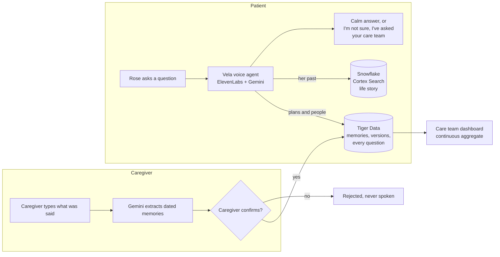

<p align="center">
  
</p>

<h1 align="center">Vela</h1>

<p align="center">
  <strong>A voice companion for older adults living at home, and the people who care for them.</strong><br />
  It answers calmly and correctly, every time, using only what a caregiver has confirmed.
</p>

<p align="center">
  <a href="https://devpost.com/software/vela-25l69m">Devpost</a> ·
  <a href="#demo-video">Demo video</a> ·
  Website (link coming soon)
</p>

<p align="center"><em>Built in 48 hours at Hack Knight Fall 2026, Queens College.</em></p>

The name comes from the Spanish *velar*: to keep watch over someone, especially through the night.

---

## Demo video

*Launch video coming soon.*


---

## The problem

More and more older adults are aging at home, often alone, while their families juggle work and distance. They need someone to ask: *What day is it? When is my appointment? Who's coming today?* And their families need to know that they're okay.

The hardest version of this is memory loss. Someone living with dementia may ask the same question many times an hour: *"When is Anna picking me up?"* Caregivers love them, answer every time, and burn out.

A normal AI chatbot is the wrong tool here. It guesses when it doesn't know, invents details, and might happily say *"yes, you already took your pills."* For an older adult, and especially for someone with memory loss, a confident wrong answer is worse than no answer.

**We built Vela first for memory loss, the case where a wrong answer does the most harm.** If it's patient and trustworthy enough for that, it's trustworthy for every older adult living at home.

## What Vela does

Vela is a calm voice companion on a simple kiosk screen at home, with a separate set of pages for family members and the care team. Our demo follows **Rose**, 80, who lives alone in Queens and is starting to have trouble with her memory.

**For the patient**
- **Tap the flame and ask anything.** Vela answers in one or two calm sentences, and the sixth answer sounds exactly like the first.
- **Only confirmed facts.** Before answering a question about plans or people, Vela looks up memories a caregiver has confirmed. If the answer isn't there, it says so and asks the care team instead of guessing.
- **Her life story.** Questions about her past ("What did I do for work?") are answered from a life story the family wrote.
- **Her first language.** English, Spanish, or Chinese, chosen on the screen. The whole screen and the conversation switch, and Vela follows if she changes languages mid conversation.
- **Reminders.** Vela speaks a reminder before each confirmed plan, and Rose can ask for her own: *"Remind me in 2 minutes to call Joan."*
- **Family messages.** A message written by a family member plays in that person's own cloned voice, with their consent. The live companion always keeps its own neutral voice.
- **Emergencies.** *"I fell"* or *"my chest hurts"* raises an urgent alert for the care team immediately, with a keyword backup that doesn't depend on the AI. Falls are a leading risk for anyone living alone, not only people with memory loss.

**For family and the care team** (PIN protected)
- **Memories:** type what a caregiver said in plain words. Gemini turns it into dated memories, and nothing is spoken until a person confirms it. Plans can be updated or cancelled, and every version is kept.
- **Today:** a dashboard of what the patient asked about and how often, open alerts, and anything she said she did (marked not verified).
- **Conversations:** every question and answer, each with a receipt showing which memory the answer came from.
- **Alerts, Life story, Family messages, and Patient** settings, including a one click demo reset.

**Screenshots coming soon:**
- *The patient screen: the flame, the clock, and the "Coming up" card*
- *Reviewing a memory on the staff Memories page*
- *The care team dashboard*
- *The patient screen in Spanish and Chinese*

## How it works



1. A caregiver types what they told the patient: *"Your dentist appointment is tomorrow at three, Anna picks you up at two thirty."*
2. Gemini returns a structured form. Code, not the model, builds the exact date and time, so daylight saving and "next Tuesday" are handled the same way every time.
3. The caregiver sees the resolved time and their own words, then confirms. Until then, nothing is spoken.
4. When the patient asks, the agent calls a tool that reads only confirmed memories. A plan that changes gets a new version, and the old one is never said again.

## Built for trust

| Rule | How it's enforced |
|---|---|
| Never guesses | If no memory answers the question, Vela says it isn't sure and raises a care team alert. A backup on the patient page raises it even if the AI forgets. |
| Only confirmed memories | Pending, rejected, cancelled, and replaced memories are filtered out in SQL, then checked again in code. The database itself rejects a confirmed memory without a confirmation time. |
| Never confirms medicine | Vela never says whether a dose was taken or suggests one. *"I took my pills"* is logged as self reported and flagged for the care team. Medication is never extracted as a memory. |
| Honest about being AI | It says it's a computer helper when asked. A family member's cloned voice only reads words they wrote. |
| Emergencies first | Falls, chest pain, trouble breathing, and being lost raise an urgent alert before Vela replies, in all three languages. It never promises that someone is on the way. |
| Explainable answers | Every answer is logged with the memories it used, so staff can see exactly why Vela said something. |

## Tech stack

| Tool | What it does in Vela |
|---|---|
| **ElevenLabs** | The voice agent (speech recognition, reasoning, and speech in one loop) with client tools; instant voice cloning and text to speech for family messages; spoken reminders; Spanish and Chinese voices |
| **Google Gemini** | Turns caregiver text into structured, dated memories and detects updates; also the agent's language model |
| **Tiger Data** | Postgres with TimescaleDB: memories with full version history, every question in a hypertable, and a continuous aggregate behind the care team dashboard |
| **Snowflake** | Cortex Search over the patient's life story, so Vela can talk about her past without guessing |
| **GoDaddy Registry** | The project domain |
| **React, Vite, TypeScript** | The patient kiosk and the staff pages |
| **FastAPI (Python)** | The API, the memory rules, reminders, and every integration |

## Testing

Vela is tested against the live agent, not just demoed.

| Suite | What it covers |
|---|---|
| `safety_tests.py` | Simulated conversations with the real ElevenLabs agent: repeated questions, made up details, medicine, emergencies, honesty about being an AI, the life story, family messages, reminders, Spanish, and Mandarin. Writes `docs/safety-report.md` with every reply quoted as evidence. |
| `extraction_tests.py` | Caregiver sentences into memories, including relative days, all day plans, updates, and the night daylight saving time ends |
| `review_tests.py` | Confirming, rejecting, cancelling, and version chains against the real database |
| `records_tests.py` | Answers, alerts, self reports, family messages, the dashboard, and demo reset |
| `patient_reminders_tests.py` | Reminders the patient sets: time rules, delivery, and that they're never told back as facts |
| `life_story_tests.py` | Snowflake search: only passages that actually answer the question reach the agent |

<!-- Update after the final full run of safety_tests.py -->
**Latest safety run: 41 of 41 checks passed.** See [`docs/safety-report.md`](docs/safety-report.md).

## Running locally

**You'll need:** Python 3.10+, Node 18+, and accounts for ElevenLabs, Google AI Studio (Gemini), Tiger Cloud, and Snowflake.

**1. Configure the backend.** Copy `backend/.env.example` to `backend/.env` and fill in the keys. `STAFF_PIN` must be digits only.

**2. Install and set up** (PowerShell; use `.venv/bin/python` on macOS or Linux):

```powershell
cd backend
python -m venv .venv
.\.venv\Scripts\pip install -r requirements.txt
.\.venv\Scripts\python scripts\init_db.py          # creates the Tiger Data tables (safe to rerun)
.\.venv\Scripts\python scripts\seed_demo.py        # loads the demo patient, Rose
.\.venv\Scripts\python scripts\create_agent.py     # first time only, then add ELEVENLABS_AGENT_ID to .env
cd ..
npm run install:all
```

**3. Snowflake life story (optional).** Run `backend/scripts/snowflake_setup.sql` in a Snowsight worksheet, copy the names it prints into `backend/.env`, then load the demo life story:

```powershell
cd backend
.\.venv\Scripts\python scripts\seed_life_story.py
```

**4. Start both servers** from the repo root:

```powershell
npm run dev
```

- Patient screen: http://localhost:5173/patient
- Staff pages: http://localhost:5173/care (PIN is `STAFF_PIN`)
- API: http://localhost:8000 (interactive docs at `/docs`)

To run without a database (for example, on a network that blocks Postgres), leave `DATABASE_URL` empty and the app uses built in demo data.

## Project structure

```
backend/
  app/
    memory/      memories, extraction (Gemini), review, life story (Snowflake), records
    voice/       the agent config, sessions, family messages, reminders
    store.py     every read and write to Tiger Data
  scripts/       setup, seeding, and test suites
frontend/
  src/
    pages/patient/   the kiosk screen
    pages/care/      the staff pages
    voice/           the flame, agent tools, and conversation logging
    i18n.ts          English, Spanish, and Chinese text
docs/
  safety-report.md   the latest safety run
  memory-track.md    design decisions for the memory system
```

## What's next

- **Beyond memory loss:** daily check ins, medication schedules managed by the care team, and appointment prep for any older adult living alone
- **Testing with caregivers** and home care agencies, who would use the dashboard across many clients
- **More languages,** chosen by the family
- **A dedicated home device,** like a tablet stand or a smart speaker with a screen

## Team

<!-- Add GitHub or LinkedIn links -->
- **Daniel Lin** ([@daniellin112904](https://github.com/daniellin112904))
- **Yunzhe Zheng** ([@YunzheOVE](https://github.com/YunzheOVE))
- **James Lacoste** ([@Jlac17](https://github.com/Jlac17))

## Acknowledgments

Built at [Hack Knight Fall 2026](https://hack-knight-fall-2026.devpost.com/) at Queens College, with thanks to Major League Hacking and the sponsors whose tools power Vela: ElevenLabs, Google Gemini, Tiger Data, Snowflake, and GoDaddy Registry.

*Rose and her family are fictional. Vela is a hackathon prototype and is not a medical device.*